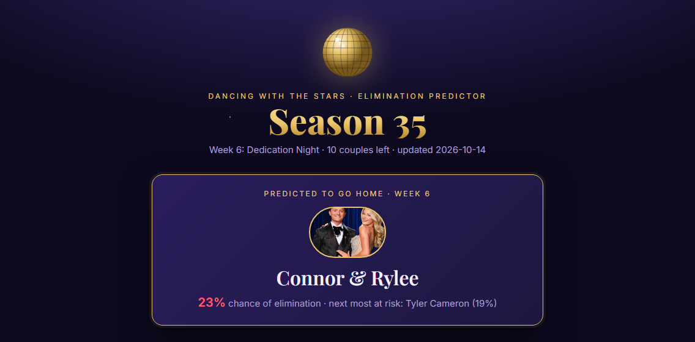
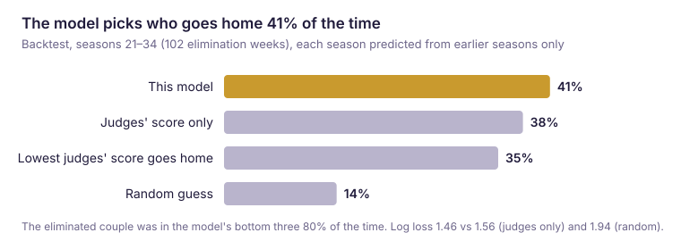
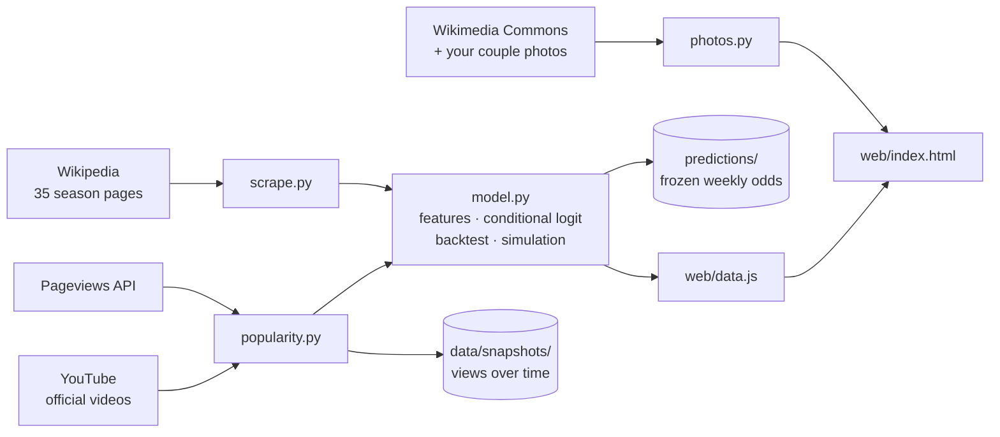
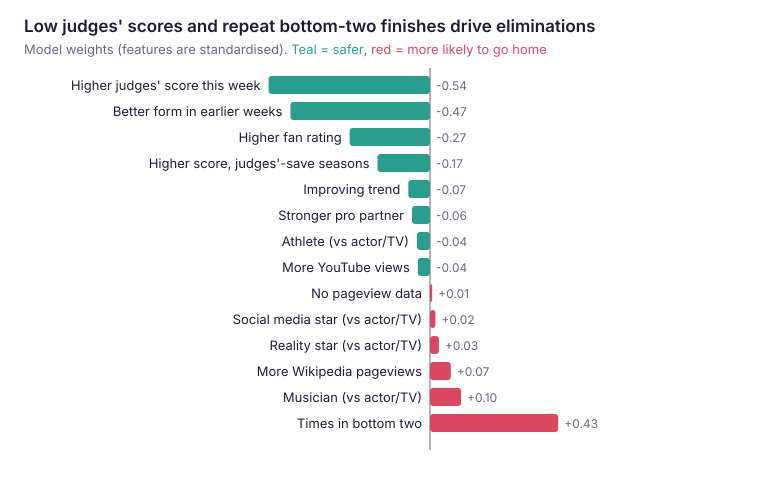
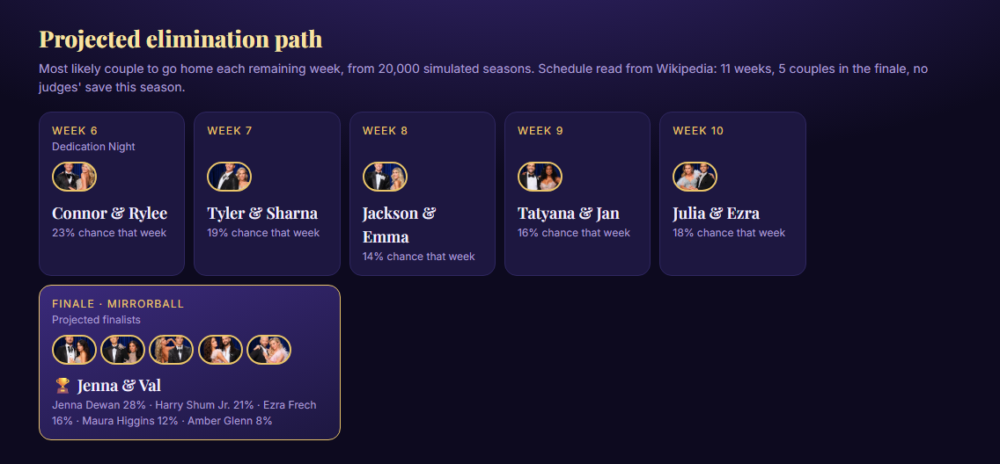
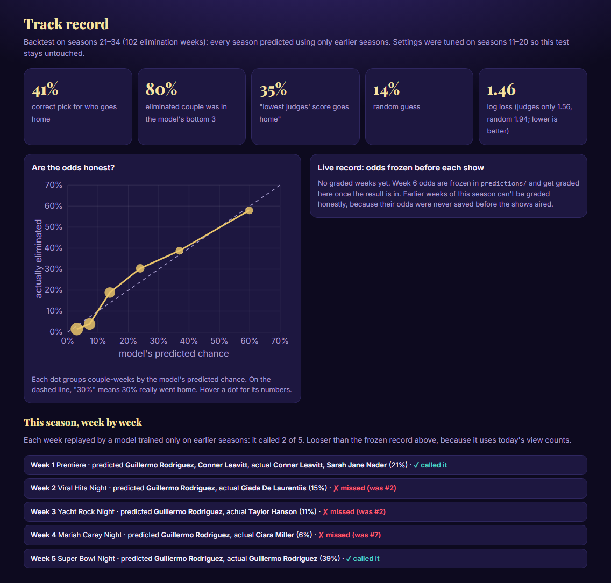
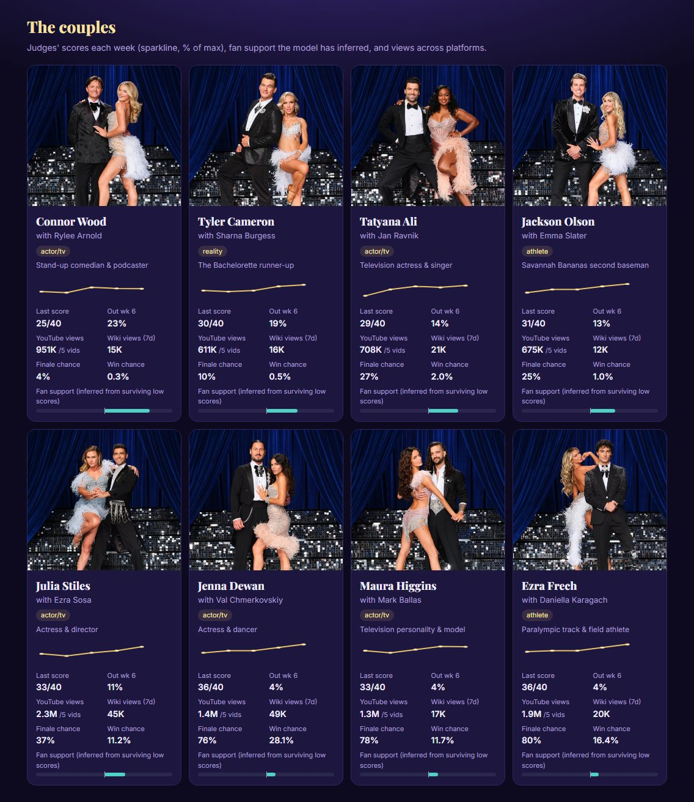

# DWTS Elimination Predictor

A machine-learning model that predicts who gets eliminated each week on *Dancing with the Stars*, then simulates the rest of the season to give every couple odds of going home, reaching the finale and winning the Mirrorball. It works like the World Cup predictors that turn team ratings into match odds and replay the tournament thousands of times.



## At a glance

- **Data:** scraped all 35 seasons from Wikipedia (about 3,600 performances, 330 eliminations), plus popularity signals from YouTube and Wikipedia pageviews.
- **Model:** a conditional logit (a logistic regression normalized within each week), implemented from scratch in NumPy/SciPy, plus a 20,000-run Monte Carlo of the rest of the season.
- **Result:** picks the eliminated couple **41%** of the time vs **35%** for "lowest judges' score goes home" and **14%** for random guessing. The eliminated couple is in its bottom three **80%** of the time.
- **Honest evaluation:** each test season is predicted only from earlier seasons, tuning happens on separate seasons, and live predictions are frozen before each show airs.
- **Front end:** a static, DWTS-themed web page with no backend.



## Why this is a hard problem

Each week the judges score every couple and the audience votes. The lowest **combined** total goes home. The judges' scores are public; the fan votes never are. So half of the signal is hidden.

- **Fans override judges.** The lowest judges' score goes home only about a third of the time. This season Guillermo Rodriguez survived four weeks with the lowest score.
- **Small data.** About 330 eliminations in 35 seasons, and only 102 in the modern seasons used for testing. Complex models overfit.
- **Rules change.** In seasons 28–31 fans picked the bottom two and the judges chose who left (the "judges' save"), so judges' scores mattered more.
- **Popularity data is thin.** Official YouTube performance videos only go back to season 34, and old view counts include views from after the season.

## How it works



1. **Scrape** (`scrape.py`). Each season page has a cast table and one table per week (couple, score, dance, result). Formats changed over 20 years, so the scraper expands merged cells into a clean grid and finds columns by header name. It matches couple labels like "Connor W. & Rylee" to the cast using name tokens plus the pro's first name. It also reads each season's length and detects the judges'-save era.
2. **Popularity** (`popularity.py`). Daily Wikipedia pageviews (cached, with exponential backoff when rate-limited) summed over the 7 days before each show. Views on the official channel's performance videos, parsed from YouTube's search results. Every run **appends** to `data/snapshots/`, building the point-in-time history that old view totals can't provide.
3. **Photos** (`photos.py`). Couple photos you add to `web/img/custom/`, falling back to each person's Wikipedia portrait.
4. **Model** (`model.py`). Builds features, fits the model, backtests it, simulates the season, freezes this week's odds and writes `web/data.js` for the page.

## Features

Every feature is measured **relative to that week's field**, because the model only has to rank couples within a week.

| Feature | What it captures |
|---|---|
| Judges' score (z-score within the week) | Lower scores lose; z-scores make /30 and /40 weeks comparable |
| Judges' score × judges'-save season | Scores matter more when judges choose who leaves |
| Form and trend | Average of earlier weeks, and whether the couple is improving |
| Times in the bottom two | Repeated trouble signals a weak fanbase |
| **Fan rating** | An Elo-style rating for the audience: a couple earns credit each week they survive a score the judges alone would have sent home, and loses it when they land in the bottom two despite good scores |
| Pro partner strength | The pro's average finish in earlier seasons, shrunk toward average |
| Celebrity type | Athlete, reality star, musician, social media or actor/TV, parsed from the cast table |
| YouTube views, Wikipedia pageviews | Log views, standardized within the week; missing-data flags keep old seasons usable |
| Dance style (simulation only) | When dances are announced, projected scores shift by that style's historical effect |

No feature uses information from after the week it predicts: running features are shifted by a week and pro strength uses only earlier seasons.

## The model

Each couple *i* in week *g* gets a danger score `x_i · β`, and a softmax turns the scores into odds that add to 100% for the week:

```
P(i eliminated | week g) = exp(x_i · β) / Σ_{j in g} exp(x_j · β)
```

The weights β maximize the likelihood of the eliminations that actually happened, minus a ridge (L2) penalty. scikit-learn has no conditional logit, so I wrote the loss and its analytic gradient in NumPy and optimize with SciPy's L-BFGS.

**Why not plain logistic regression or gradient boosting?** Exactly one couple (sometimes two) leaves each week, and the conditional logit builds that in; plain logistic regression would treat couple-weeks as independent. With ~330 events, a regularized 15-weight linear model is hard to overfit, and every weight can be sanity-checked:



**Simulation.** For the rest of the season, each run draws judges' scores around each couple's recent form, computes the week's odds, samples who goes home, and updates form, bottom-two counts and fan ratings. Across 20,000 runs it counts how often each couple goes home each week, reaches the finale and wins. The season length (11 weeks) and finale size (5 couples) are read from the data rather than hard-coded. The finale winner is ranked by buzz plus form, because there are too few finales to fit a model on.



## Evaluation

| Method (seasons 21–34, 102 weeks) | Correct pick | Log loss (lower is better) |
|---|---|---|
| **This model** | **41%** (bottom 3: 80%) | **1.46** |
| Judges' score only (same model, one feature) | 38% | 1.56 |
| Lowest judges' score goes home | 35% | — |
| Random guess | 14% | 1.94 |

- **Leave-future-out backtest.** Every test season is predicted by a model trained only on earlier seasons, the way it's used in real life. A random train/test split would leak future seasons into the past.
- **Separate tuning seasons.** The one tuning choice (ridge strength) is picked by log loss on seasons 11–20, so seasons 21–34 are never used to make a decision.
- **Log loss and calibration, not just accuracy.** The product is odds, so the probabilities have to be right. When the model says 60%, 58% actually went home.
- **Ablation.** Each feature group was removed and re-tested. With 102 test weeks the gains are small and within noise, and I report them that way.
- **Frozen live predictions.** Before each show the run saves that week's odds to `predictions/` (and again after the judges' scores). They're never rewritten once a result exists, and only frozen weeks count toward the live record.



## What the data showed

- **The hidden fan vote can be inferred.** Surviving low scores (the fan rating) and repeated bottom-two finishes are the strongest signals after the judges' scores themselves.
- **Fame isn't a fanbase.** Eliminated couples had slightly *more* Wikipedia pageviews. Already-famous actors have big Wikipedia pages, while reality and social stars have more engaged voters.
- **YouTube points the right way.** In seasons 34 and 35, eliminated couples had 0.5–0.7 standard deviations fewer views, but with one season of history the model can't lean on it yet.
- **Rules matter.** Judges' scores carry about 30% more weight in judges'-save seasons.



## Trade-offs and limitations

- **Interpretable over flashy.** A small linear model I can explain beats a black box on 330 events.
- **Honest numbers over big numbers.** An earlier version reported 48% with a generous metric. I switched to partial credit on double-elimination weeks for every method, which dropped the headline to 41%. I also kept the ridge strength chosen on the tuning seasons even though the test seasons would have preferred a smaller one.
- **Static site.** Python writes one `data.js` file, so the page needs no server and can be hosted for free.
- **Known gaps:** fan votes are never published; Instagram and TikTok block scraping (enter follower counts by hand in `data/social_manual.csv`); the finale is hand-tuned; the scraper depends on Wikipedia's table layout.

**Next steps:** a ranking model for the finale, real social media APIs, a skill-curve model for projected scores, and a scheduled GitHub Action that runs the pipeline after each show and publishes the page to GitHub Pages.

## Run it

```bash
python -m venv .venv
.venv/Scripts/pip install -r requirements.txt
.venv/Scripts/python run.py
python -m http.server 8765 --directory web
```

Then open http://localhost:8765. On macOS/Linux, use `.venv/bin/` instead of `.venv/Scripts/`.

Run `run.py` **before** each show to freeze that week's odds, and again **after** it to grade them and pick up the new scores. `python docs/make_figures.py` redraws the README charts.

**Couple photos:** save each couple's photo into `web/img/custom/`, named after the celebrity (for example `connor-wood.png`). Couples without one show their Wikipedia portraits.

## Repository layout

| Path | Contents |
|---|---|
| `scrape.py` | Wikipedia scraper: cast, weekly scores and results, season length, judges'-save era |
| `popularity.py` | Wikipedia pageviews, YouTube views, snapshot log |
| `photos.py` | Couple photos and Wikipedia portraits |
| `model.py` | Features, conditional logit, backtest, calibration, simulation, frozen predictions |
| `run.py` | Runs the whole pipeline |
| `web/` | The page (`index.html`), its data (`data.js`) and images |
| `data/` | Scraped CSVs and `snapshots/` (view counts over time) |
| `predictions/` | Odds frozen before each show |
| `docs/` | README screenshots and charts (`make_figures.py`) |

## Data sources

- Wikipedia season pages for *Dancing with the Stars* (US), seasons 1–35
- Wikimedia Pageviews API, and Wikimedia Commons for portraits
- YouTube search results (official Dancing With The Stars channel)
- Couple photos are ABC promotional images and belong to their owners

*A personal project for fun; not affiliated with ABC or Dancing with the Stars.*
