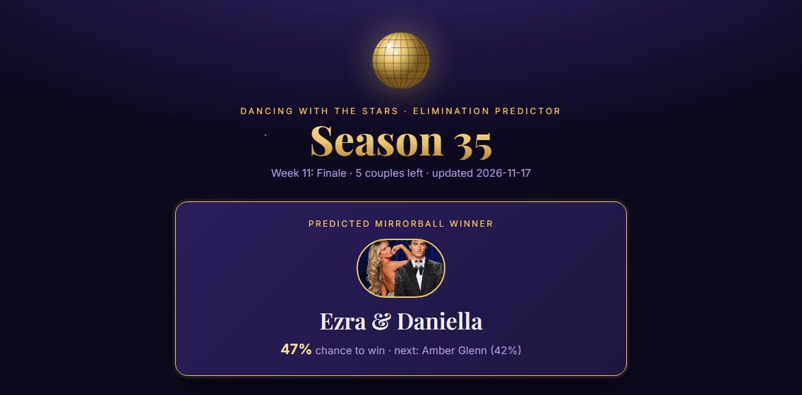
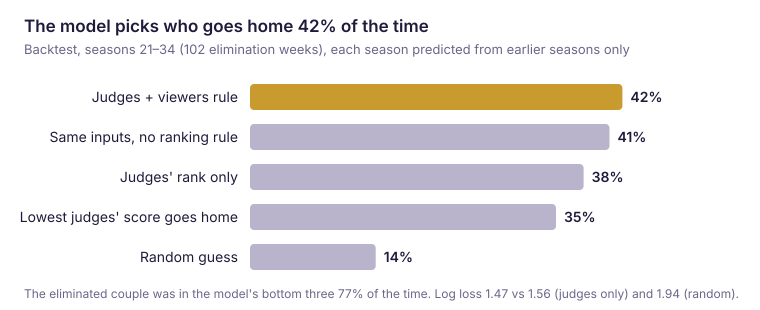
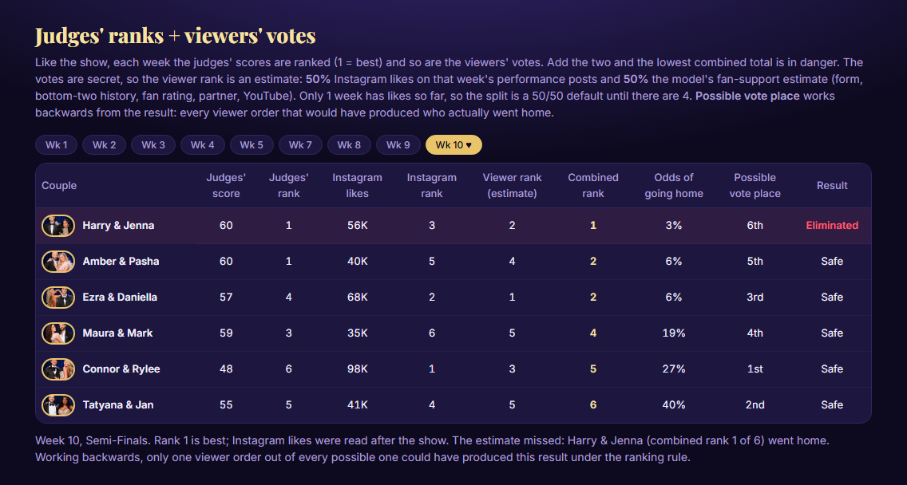
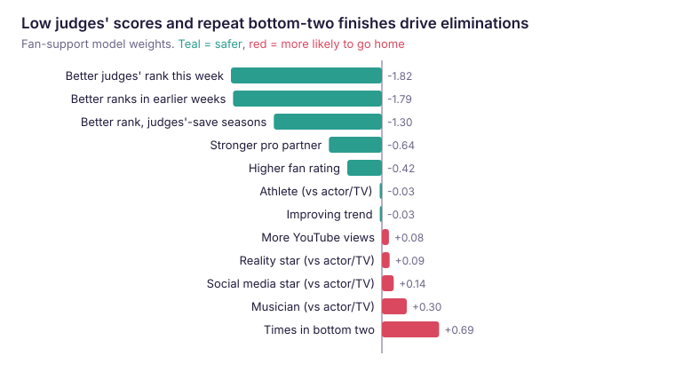
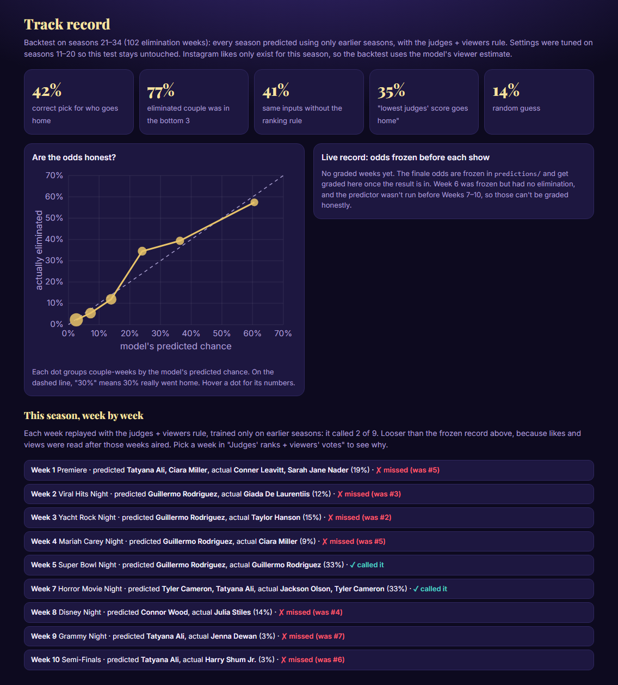
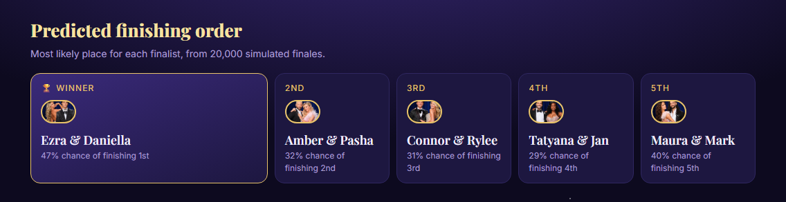
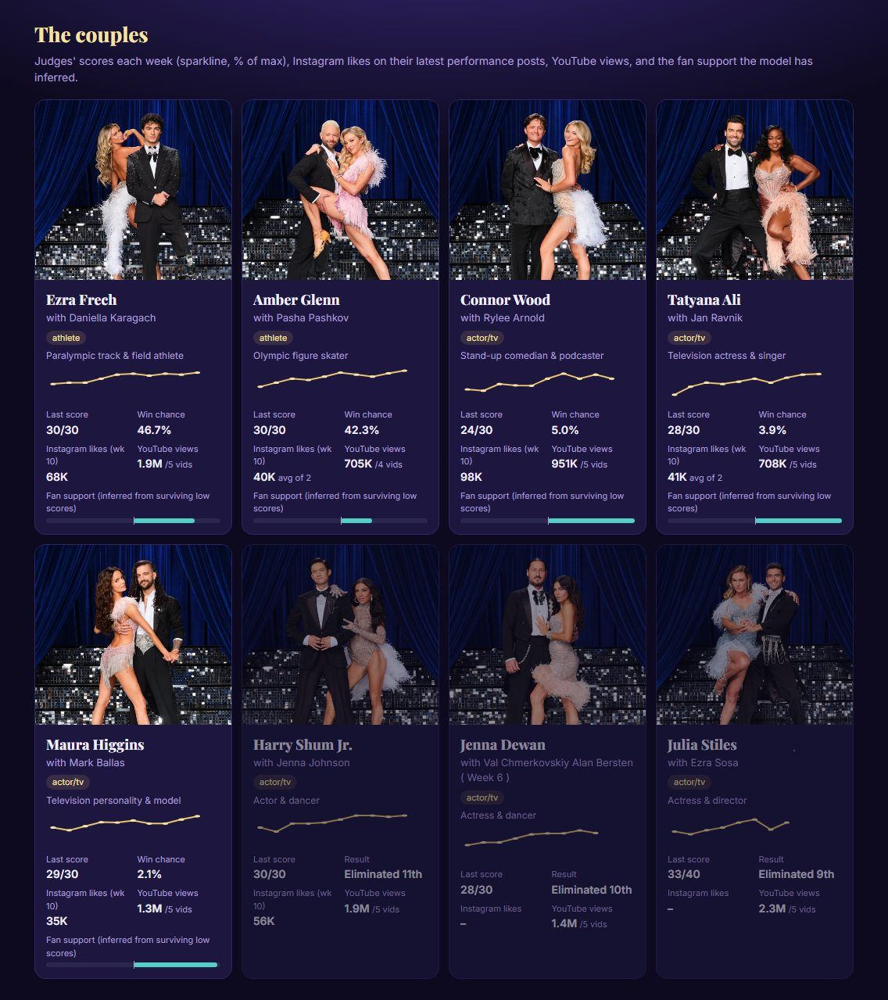

# DWTS Elimination Predictor

A machine-learning model that predicts who gets eliminated each week on *Dancing with the Stars*, then simulates the rest of the season to give every couple odds of going home, of each finishing place in the finale, and of winning the Mirrorball. It copies the show's own rule: **judges' ranks + viewers' votes, lowest combined total goes home**. Viewer votes are secret, so the model estimates them from Instagram likes and 35 seasons of history.



## At a glance

- **Data:** all 35 seasons scraped from Wikipedia (about 3,600 performances, 330 eliminations), plus Instagram likes on the show's performance posts and YouTube views.
- **Model:** judges' rank points plus estimated viewers' rank points, turned into odds by a softmax fit on every past elimination. The viewer estimate blends Instagram likes with a conditional logit I implemented from scratch in NumPy/SciPy. A 20,000-run Monte Carlo then plays out the rest of the season and the finale.
- **Result:** picks the eliminated couple **42%** of the time, vs **35%** for "lowest judges' score goes home" and **14%** for a random guess. The eliminated couple is in its bottom three **77%** of the time.
- **Vote inference:** after each week it works backwards from who went home to find which viewer rankings were even possible.
- **Honest evaluation:** each test season is predicted only from earlier seasons, tuning happens on separate seasons, and live predictions are frozen before each show airs.
- **Front end:** a static, DWTS-themed web page with no backend.



## Why this is a hard problem

Each week the judges score every couple and the audience votes; the two are combined and the lowest total goes home. The judges' scores are public. The votes never are, so half the signal is hidden.

- **Fans override judges.** The lowest judges' score goes home only about a third of the time. In the season 35 semifinal, Harry Shum Jr. got a perfect 60/60 and was eliminated, while Connor Wood had the lowest score (48) and survived.
- **Small data.** About 330 eliminations in 35 seasons, and only 102 in the modern seasons used for testing. Complex models overfit.
- **Rules change.** In seasons 28–31 fans picked the bottom two and the judges chose who left (the "judges' save").
- **Popularity data is thin.** Instagram shows logged-out visitors only the newest posts, and official YouTube performance videos only go back to season 34.

## How it works

```mermaid
flowchart LR
    W[Wikipedia<br/>35 season pages] --> S[scrape.py]
    IG[Instagram<br/>@dancingwiththestars likes] --> I[instagram.py]
    Y[YouTube<br/>official videos] --> Pop[popularity.py]
    C[Wikimedia Commons<br/>+ couple photos] --> Ph[photos.py]
    S --> M[model.py<br/>judges' ranks + viewers' ranks<br/>backtest · simulation]
    I --> M
    Pop --> M
    Pop --> Snap[(data/snapshots/<br/>views over time)]
    I --> Snap
    M --> Pred[(predictions/<br/>frozen weekly odds)]
    M --> D[web/data.js]
    Ph --> UI[web/index.html]
    D --> UI
```

1. **Scrape** (`scrape.py`). Each season page has a cast table and one table per week (couple, score, dance, result). Formats changed over 20 years, so the scraper expands merged cells into a clean grid and finds columns by header name. It matches couple labels like "Connor W. & Rylee" to the cast using name tokens plus the pro's first name, reads each season's length, and detects the judges'-save era.
2. **Instagram** (`instagram.py`). Like counts on @dancingwiththestars' performance posts. With a Meta Graph API token it uses the official **Business Discovery** endpoint to page back through the account, match each caption to a couple and assign it to a show week by timestamp. Without a token it reads `data/instagram_posts.csv`, a hand-filled list of post links and like counts. Every reading is logged to `data/snapshots/`.
3. **YouTube** (`popularity.py`). Median views per official performance video, parsed from YouTube search results, also logged over time.
4. **Photos** (`photos.py`). Couple photos you add to `web/img/custom/`, falling back to each person's Wikipedia portrait.
5. **Model** (`model.py`). Builds features, fits the model, backtests it, simulates the season, freezes this week's odds and writes `web/data.js` for the page.

## The rule: judges' ranks + viewers' votes



Each week, for each couple:

1. **Judges' rank points.** Rank the week's judges' scores, best = 1.0 down to worst = 0.0. Ties share the better rank, as on the show.
2. **Viewers' rank points.** Votes are secret, so this is an estimate that blends two rankings:
    - **Instagram likes** on that week's performance posts. Likes keep growing for days, so they're only compared within a week, as ranks.
    - **A fan-support estimate** learned from 35 seasons: the non-judge part of a conditional logit over form, bottom-two history, an Elo-style fan rating, pro partner, celebrity type and YouTube views.

   Instagram's share of the blend is fit by maximum likelihood once 4 or more weeks have likes; until then it's a 50/50 default.
3. **Combined.** Judges' points + viewers' points. A softmax turns the totals into odds that add to 100% for the week:

```
P(i eliminated | week) = exp(-k · combined_i) / Σ_j exp(-k · combined_j)
```

`k` is fit on every past elimination. The finale applies the same rule repeatedly, so whoever comes out first finishes 5th, then 4th, and so on down to the winner.

**Why a conditional logit for the fan estimate?** Exactly one couple (sometimes two) leaves each week, and the conditional logit builds that in; plain logistic regression would treat couple-weeks as independent. scikit-learn has no conditional logit, so I wrote the loss and its analytic gradient in NumPy and optimize with SciPy's L-BFGS. With ~330 events, a regularized 13-weight linear model is hard to overfit, and every weight can be sanity-checked:



| Input | What it captures |
|---|---|
| Judges' rank points (and × judges'-save season) | The week's scores, ranked; they matter more when judges choose who leaves |
| Form and trend | Judges' ranks in earlier weeks, and whether the couple is improving |
| Times in the bottom two | Repeated trouble signals a weak fanbase |
| **Fan rating** | An Elo-style rating for the audience: credit each week a couple survives a score the judges alone would have sent home, lost when they land in the bottom two despite good scores |
| Pro partner strength | The pro's average finish in earlier seasons, shrunk toward average |
| Celebrity type | Athlete, reality star, musician, social media or actor/TV, parsed from the cast table |
| YouTube views | Log median views per official video, standardized within the week |

No input uses information from after the week it predicts. Wikipedia pageviews were tried and dropped: they track fame, not fans who vote.

## Working backwards from results

The page also inverts the rule. Given the judges' scores and who went home, it tries every possible viewer order (all *n*! of them, for fields of 9 or fewer) and keeps only those that would have produced the actual result.

In the season 35 semifinal, **only 1 of the 720 possible viewer orders** fits. Harry & Jenna, tied for the best judges' score, must have finished **dead last** in the vote. Connor & Rylee, last with the judges, must have **won** the vote outright, and that only got them to a tie, broken in their favour by votes. The vote order that fits is the exact reverse of the judges' order. Under the alternative percentage rule (judges' share + vote share), Harry still had to be last in votes.

## Evaluation

| Method (seasons 21–34, 102 weeks) | Correct pick | Log loss (lower is better) |
|---|---|---|
| **Judges + viewers rule** | **42%** (bottom 3: 77%) | 1.47 |
| Same inputs as a plain conditional logit | 41% | **1.44** |
| Judges' rank only | 38% | 1.56 |
| Lowest judges' score goes home | 35% | — |
| Random guess | 14% | 1.94 |

- **Leave-future-out backtest.** Every test season is predicted by a model trained only on earlier seasons, the way it's used in real life. A random train/test split would leak future seasons into the past.
- **Separate tuning seasons.** The one tuning choice (ridge strength) is picked by log loss on seasons 11–20, so seasons 21–34 are never used to make a decision.
- **Log loss and calibration, not just accuracy.** The product is odds, so the probabilities have to be right. The ranking rule picks slightly better, while the plain logit has slightly sharper odds; both differences are within noise on 102 weeks.
- **Instagram can't be backtested.** Likes only exist for this season, so historical tests use the model's viewer estimate alone. Instagram's real value will show in the frozen live record.
- **Frozen live predictions.** Before each show the run saves that week's odds to `predictions/` (and again after the judges' scores). They're never rewritten once a result exists, and only frozen weeks count toward the live record.



## Season 35 finale prediction





## Trade-offs and limitations

- **Interpretable over flashy.** A small model built around the show's real rule, which I can explain line by line, beats a black box on 330 events.
- **Honest numbers over big numbers.** An earlier version reported 48% with a generous metric. I switched to partial credit on double-elimination weeks for every method, which dropped the headline. I also kept the ridge strength chosen on the tuning seasons even when the test seasons would have preferred another.
- **Likes are a proxy, not votes.** In the semifinal, Instagram likes put Harry 3rd and Maura last; the result shows Harry was really last in votes. The fitted Instagram share will settle how much likes deserve.
- **Known gaps:** the Graph API needs your own Business account and token; without it, older weeks need post links entered by hand. The scraper depends on Wikipedia's table layout.

**Next steps:** collect Instagram likes for every week through the Graph API so the Instagram share can be fit, use the inferred viewer orders as extra training data, and add a scheduled GitHub Action that runs the pipeline after each show and publishes the page.

## Run it

```bash
python -m venv .venv
.venv/Scripts/pip install -r requirements.txt
.venv/Scripts/python run.py
python -m http.server 8765 --directory web
```

Then open http://localhost:8765. On macOS/Linux, use `.venv/bin/` instead of `.venv/Scripts/`.

Run `run.py` **before** each show to freeze that week's odds, and again **after** it to grade them and pick up the new scores. `python docs/make_figures.py` redraws the README charts.

**Instagram likes.** Either set `IG_USER_ID` and `IG_ACCESS_TOKEN` (your own Instagram Business/Creator account linked to a Facebook Page, plus a Meta app token) and `instagram.py` pulls them through the official Graph API, or add rows to `data/instagram_posts.csv` (season, week, celebrity, post link, likes).

**Couple photos.** Save each couple's photo into `web/img/custom/`, named after the celebrity (for example `connor-wood.png`). Couples without one show their Wikipedia portraits.

## Repository layout

| Path | Contents |
|---|---|
| `scrape.py` | Wikipedia scraper: cast, weekly scores and results, season length, judges'-save era |
| `instagram.py` | Instagram likes via the Graph API or a hand-filled CSV |
| `popularity.py` | YouTube views, show dates, snapshot log |
| `photos.py` | Couple photos and Wikipedia portraits |
| `model.py` | Judges + viewers rule, fan-support model, backtest, calibration, vote inference, simulation, frozen predictions |
| `run.py` | Runs the whole pipeline |
| `web/` | The page (`index.html`), its data (`data.js`) and images |
| `data/` | Scraped CSVs, Instagram posts, and `snapshots/` (likes and views over time) |
| `predictions/` | Odds frozen before each show |
| `docs/` | README screenshots and charts (`make_figures.py`) |

## Data sources

- Wikipedia season pages for *Dancing with the Stars* (US), seasons 1–35
- Instagram like counts on @dancingwiththestars' posts (Meta Graph API or read by hand)
- YouTube search results (official Dancing With The Stars channel)
- Wikimedia Commons portraits; couple photos are ABC promotional images and belong to their owners

*A personal project for fun; not affiliated with ABC or Dancing with the Stars.*
